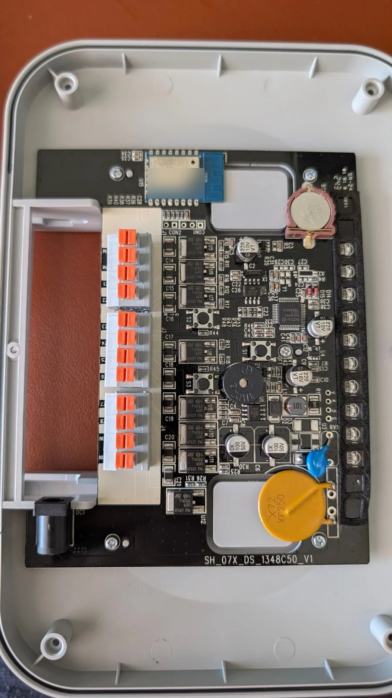
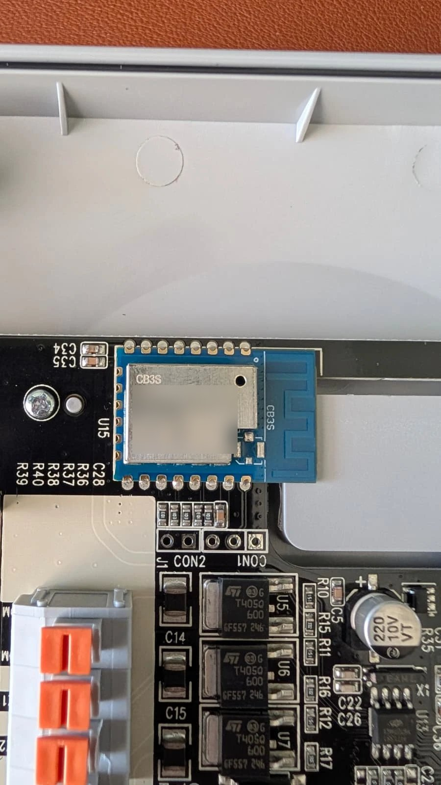

# Gadnic RIEGAUT6: 8-zone Wi-Fi irrigation controller (teardown)

**Status: teardown notes only. No ESPHome package yet, and nothing has been
flashed.** This page records what is inside the unit so the next step can be
planned. Anything marked *unconfirmed* is read off the photos and not yet
checked with a meter or a datasheet.

## The product

- Sold as **Gadnic RIEGAUT6** ("Programador de riego"). The same white and grey
  case, with a black LED strip and a round three-button pad, is sold under
  other names as a generic "Tuya 8-zone sprinkler controller".
- Manual (Spanish, PDF):
  [gadnic.com.ar/descargas/RIEGAUT6.pdf](https://www.gadnic.com.ar/descargas/RIEGAUT6.pdf)
- **Stock app:** Smart Life / Tuya. It pairs as "Smart Watering Timer" and needs
  the Tuya cloud.
- **Power:** an included AC-to-AC adapter, 230 V 50 Hz in, **24 VAC 2000 mA** out,
  into a barrel jack on the board.
- **Outputs:** 8 zones for standard **24 VAC** irrigation solenoids, one valve
  per terminal. Not for DC valves: the outputs are triacs (see below).
- **Front:** power LED, Wi-Fi LED, 8 zone LEDs, buzzer, and three buttons: SELECT
  (circle, top), UP (left arrow), DOWN (right arrow).
- **Rated** -10 to 55 °C, 10–90 % RH, non-condensing. Indoor case, no IP rating.

What the stock firmware does, from the manual:

| Action | Buttons |
|---|---|
| Select a zone | Short press UP or DOWN (the zone LED blinks) |
| Zone on / off | SELECT |
| Run all zones | Hold UP about 5 s |
| Cancel all zones | Hold DOWN |
| Wi-Fi pairing mode | Hold SELECT until the Wi-Fi LED blinks fast |
| Reset | Hold UP while powering on, until 2 beeps |

App features: up to 10 timers, cycle and soak, a "Smart Weather" rain skip from
the cloud. **Only one zone runs at a time.**

## Inside

PCB silkscreen: **`SH_07X_DS_1348C50_V1`**.

| Ref | Part | Notes |
|---|---|---|
| U15 | **Tuya CB3S** Wi-Fi module (Beken **BK7231N**) |  |
| U14 | **Nations N32G4-series MCU**, LQFP-48 | A separate microcontroller next to the Wi-Fi module. Exact part number *unconfirmed* (marking hard to read). |
| U13 + X1 + BT1 | SOIC-8 chip, 32.768 kHz-style crystal, coin cell holder | Looks like a **battery-backed real-time clock**, so the MCU can keep time and schedules without Wi-Fi. *Unconfirmed.* |
| U5–U12 | **8 × ST T405Q-600** triacs | One per zone, 4 A / 600 V. Plenty of margin for a 0.3 A valve. |
| S1–S3 | Tactile buttons | Pressed by the front pad |
| — | Buzzer | Centre of the board |
| DC1 | Barrel jack | 24 VAC in from the adapter |
| RV1 + yellow disc (marked XF250) | Input protection | Varistor and what looks like a PTC fuse. *Unconfirmed.* |
| — | Buck converter (inductor "101") with 50 V electrolytics | Makes the low-voltage rail from the 24 VAC |
| CON1 (3-pin), CON2 (2-pin) | Unpopulated headers next to the module | Probably UART/programming. *Pinout unconfirmed.* |

Terminal block (push-in, top to bottom): **COM, COM, Z1–Z8, IN, IN**. The manual
doesn't mention the **IN** pair. It is probably a rain or sensor input.
*Unconfirmed.*

## What this means for ESPHome

This is **not** the TY-W-8L / TY-W-6L board that
[gnacho/esphome-tuya-8zone-valve](https://github.com/gnacho/esphome-tuya-8zone-valve)
supports. On that board the Wi-Fi chip drives the zones directly through shift
registers. Here a separate MCU (with what looks like its own clock) sits between
the Wi-Fi module and the triacs.

That points to a **TuyaMCU** design: the CB3S only talks serial to the MCU, and
the MCU runs the zones, buttons, LEDs and buzzer. If so, the plan is:

1. Back up the CB3S flash first, with
   [ltchiptool](https://github.com/libretiny-eu/ltchiptool) over UART.
2. Flash ESPHome on the CB3S (`bk72xx`, board `cb3s`) with the
   [`tuya:` component](https://esphome.io/components/tuya.html). On boot,
   ESPHome logs every datapoint the MCU reports. Map those to valve switches.
3. Keep the MCU as it is: buttons, LEDs and probably its offline schedule keep
   working.

Things to sort out before flashing:

- **UART sharing.** On TuyaMCU boards the CB3S's flashing UART is often the same
  one wired to the MCU, which can block flashing. Usual workarounds: hold the
  MCU in reset, cut or lift its TX line, or take the module off the board.
- **Power.** Run the board from its own 24 VAC adapter while flashing. Don't also
  feed 3.3 V from the USB adapter.
- If the CB3S can't be flashed, a small ESP32-C3 board wired to its pads (3V3,
  GND, TX, RX) could replace it, with ESPHome's `tuya:` component doing the
  same job. Check first that the board's 3.3 V regulator can supply an ESP32's
  Wi-Fi peaks.

## Credits

- [gnacho/esphome-tuya-8zone-valve](https://github.com/gnacho/esphome-tuya-8zone-valve):
  the TY-W-8L board this one turned out *not* to be, and a useful reference for
  flashing BK7231N irrigation controllers
- [LibreTiny](https://github.com/libretiny-eu/libretiny) and
  [ltchiptool](https://github.com/libretiny-eu/ltchiptool): ESPHome on Beken chips
